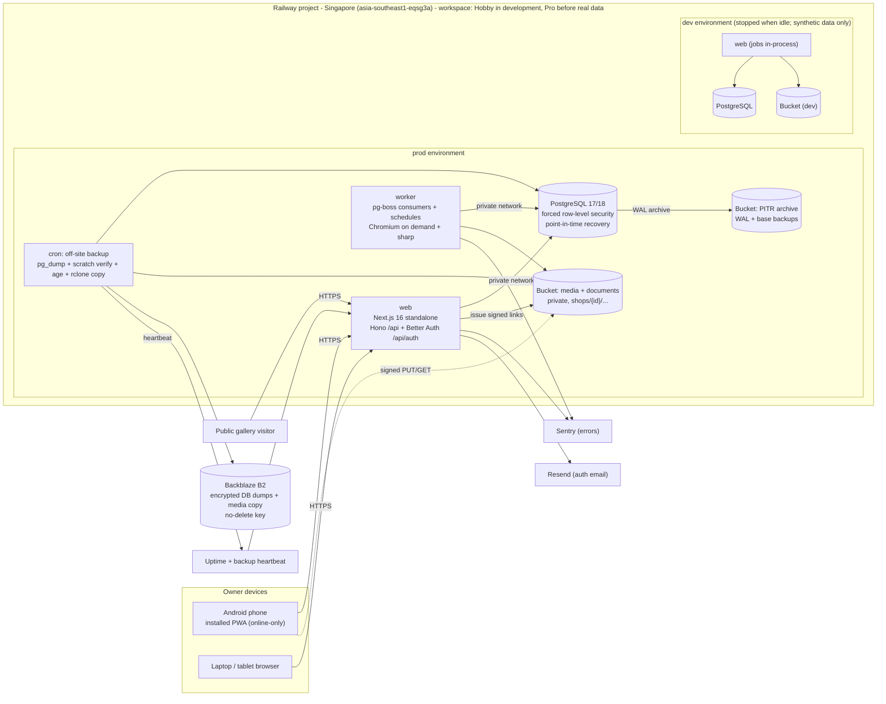

# Boutique Business Management Portal
## Architecture and Technology Decisions

**Date:** 12 October 2026
**Document status:** Final baseline for the Phase 1 build. Package versions are the 12 October 2026 snapshot with the recorded workspace compatibility correction below.
**Companion to:** [Final Product Plan](Boutique_Business_Management_Final_Product_Plan.md). That document defines what the product must do. This one defines how it is built, hosted and operated. Requirement IDs (for example USE-01, TRU-10, AC-49) refer to the product plan.
**Audience:** The developer (the owner, working with AI coding assistance) and any reviewer of technical decisions.

**Planning basis:** Decisions here serve the Phase 1 committed scope (product plan Section 29.1). Later-phase items are recorded so that Phase 1 does not block them, not so that they are built early. When this document and the product plan disagree on product behaviour, the product plan wins. When they disagree on technology, this document wins until it is formally revised.

---

## Contents

1. [Summary](#1-summary)
2. [Owner decisions](#2-owner-decisions)
3. [Architectural drivers](#3-architectural-drivers)
4. [Technology usage rules](#4-technology-usage-rules)
5. [Final technology stack](#5-final-technology-stack)
6. [Application architecture](#6-application-architecture)
7. [Responsive user interface and PWA](#7-responsive-user-interface-and-pwa)
8. [Data, tenancy and records integrity](#8-data-tenancy-and-records-integrity)
9. [Search, language and documents](#9-search-language-and-documents)
10. [Media, jobs and integrations](#10-media-jobs-and-integrations)
11. [Authentication, access and security](#11-authentication-access-and-security)
12. [Infrastructure and operations](#12-infrastructure-and-operations)
13. [Backup, recovery and continuity](#13-backup-recovery-and-continuity)
14. [Cost model and controls](#14-cost-model-and-controls)
15. [Quality gates and testing](#15-quality-gates-and-testing)
16. [Technical additions by phase](#16-technical-additions-by-phase)
17. [Risk register](#17-risk-register)
18. [Open items and recommended defaults](#18-open-items-and-recommended-defaults)

---

## 1. Summary

The product is built as a **small modular monolith**. It is a single Next.js application with a Hono API mounted inside it, plus a separate background worker built from the same code. Both use one PostgreSQL database and live in a pnpm + Turborepo monorepo. They are hosted on Railway in Singapore, with two environments (dev and prod).

Key decisions:
- **Object storage:** Railway Storage Buckets (private, Singapore), with an off-site copy to Backblaze B2.
- **Background jobs:** pg-boss 12, with jobs queued in the same database transaction as the business change and schedules in Asia/Kolkata.
- **No Server Actions for business changes.** All changes go through the Hono API, giving one path for authorisation, idempotency and version checks.
- **PWA:** installable and online-only in Phase 1, using the Next.js web-app manifest and a minimal service worker.

Five things are built in from the first commit, because they are cheap now and very expensive to add later:
- shop isolation with `shop_id` and PostgreSQL row-level security;
- money in integer paise, recorded as append-only events;
- version checks and idempotency keys on every change;
- immutable measurement and document versions with an audit history;
- the backup and restore gate (TRU-10).

**Expected cost:** about **$11–17/month in development** and **$21–45/month in the pilot**. Both are inside the owner's ceilings of under $20 and about $50 (Section 14).

## 2. Owner decisions

| Topic | Decision |
|---|---|
| Framework | Next.js (App Router) for the web application |
| Back end | Hono mounted inside Next.js, for end-to-end type safety; can be extracted into its own service later |
| UI | shadcn/ui (latest) on Tailwind CSS v4 |
| Validation | Zod |
| URL state | nuqs |
| Authentication | Better Auth: **email + password and Google sign-in** for Phase 1. Passkeys may be added later if needed |
| Database | PostgreSQL |
| Background jobs | pg-boss (PostgreSQL-backed queue) |
| Hosting | Railway: **two environments (dev and prod), both in the Singapore region**. No India data-residency requirement for now |
| Code organisation | One Next.js app plus modular internal packages in a **pnpm + Turborepo monorepo** |
| Team | **Solo developer** (the owner) with AI coding assistance builds and operates everything. Low-operations and managed options are preferred |
| Budget | Under **$20/month** (dev + prod) during development; up to about **$50/month** during the pilot |
| Connectivity | **Phase 1 is online-only.** The PWA is installable but does not capture data offline. Offline capture is an optional extension (product plan Section 31.2) |
| Object storage | **Railway Storage Buckets** (private, Singapore). Add a Cloudflare R2 public bucket for gallery images only if gallery traffic grows. Backblaze B2 holds the off-site copy |
| Lint and format | **Biome + Knip**, with **TypeScript pinned to 7.0.2** (approved workspace correction, §5.1) |
| Documentation | This single architecture document |

## 3. Architectural drivers

These product requirements shape the architecture most. Everything else is ordinary application work.

| Driver | Product plan reference | Architectural consequence |
|---|---|---|
| Installable web app usable at phone, tablet and desktop sizes. Reference device: a low- to mid-range Android phone on intermittent mobile data. | USE-01, §2, §33.2 | Mobile-first responsive layouts with three layout modes (Section 7). Small JavaScript on the critical path. Testing on a real low-end phone. |
| Online-only Phase 1 that is still honest about saving. No lost saved work, no false "saved" or "paid", no duplicates on retry. | USE-03, USE-04, AC-40, USE-08 | Server-saved drafts, visible save states, an idempotency key on every change, and no data stored on the device. |
| No silent overwrite when two edits collide. | USE-08, AC-55 | A version column on every editable record, an If-Match check and a conflict screen. Append-only versions for measurements and money. |
| Strict shop isolation, including search, exports, media and later AI. | TRU-01, AC-38 | `shop_id` on every tenant table, composite foreign keys, forced PostgreSQL row-level security, and storage keys scoped by shop. |
| Audit history, financial integrity and versioned records. | TRU-06, TRU-12, FIN-05, FIN-08, FIN-14, AC-06, AC-17–20, AC-49, AC-61, AC-62 | Append-only audit and money events, immutable versions, integer paise, a tested allocation function, and a unique UPI reference (UTR) per shop. |
| Tamil/English interface, with search across Tamil script, Tanglish and English. | USE-02, DAY-04, COM-06 | Message catalogues, business vocabulary stored as data, stored search keys, trigram indexes and an owner-editable glossary. |
| Every printable output as a PDF shareable on WhatsApp; A4 by default and A3 optional; correct Tamil text. | USE-07, COM-04, AC-64, later PAT-11 and PAT-17 | A server PDF renderer with proper Tamil shaping (headless Chromium), Web Share with files on mobile, and WhatsApp click-to-chat. |
| Private media kept separate from published gallery images; minors' images never published. | TRU-05, TRU-07, SHO-06, AC-39, AC-53 | A visibility state per asset, signed links issued only after an authorisation check, and an explicit publish command with rules that block minors' images. |
| Recovery gate: at most 24 hours of data loss, restore within one business day, a tested restore, and no repeated messages or refunds after a restore. | TRU-10, AC-56 | PostgreSQL point-in-time recovery, encrypted off-site backups, a switch that blocks outbound side effects during a restore, and a rehearsed runbook. |
| India's DPDP Act 2023 and Rules. | TRU-04, TRU-08, TRU-13 | Consent records, a register of data processors, a retention job that also covers backups, and a breach runbook. |
| Background work: PDFs, images, imports/exports, daily alerts in shop-local dates; later reminders with deduplication and a current-state check. | DAY-06, USE-05, USE-06, COM-05, AC-36 | A PostgreSQL-backed queue with jobs queued inside the business transaction, deduplication keys, scheduled jobs and a separate worker process. |
| Solo developer and a small budget. | Section 2 | Managed services, one region, one database, no Redis and no self-hosted infrastructure. |

## 4. Technology usage rules

These rules govern how each core technology is used.

| Technology | Rules |
|---|---|
| **Next.js** | The logged-in area is client-rendered and gets its data from the Hono API. Server rendering is used only for layouts and public gallery pages. Authorisation never relies on `proxy.ts` (formerly `middleware.ts`). The PWA uses `app/manifest.ts` and a minimal service worker (Section 7.2) |
| **Hono** | Mounted in one Node-runtime route handler. Routes are defined with `@hono/zod-openapi` for validation, typed clients and an OpenAPI document. One typed client is exported per module. Business logic lives in framework-free packages, so the API can be moved out later with only a new entry point (Section 6.4) |
| **shadcn/ui** | Uses **Base UI** primitives only; never mixed with Radix. Components are copied into the repo and maintained as our own code. Any drawer/bottom-sheet primitive must be actively maintained (not `vaul`) |
| **Tailwind CSS v4** | Requires Chrome 111+, Safari 16.4+ or Firefox 128+. CSS-first configuration, with explicit source discovery for monorepo packages |
| **Zod** | Zod 4 throughout. Separate schemas for drafts (may be incomplete) and commands (must be complete). An empty measurement or amount is never turned into zero. Zod Mini only if bundle size is measured as a problem |
| **TanStack** | **Query 5** for server state. **Table 9** for tables (any shadcn data-table recipe must target v9). **Virtual** only when long lists are measured to be slow. TanStack Form, DB and Start are not used |
| **Better Auth** | Sign-in only: email + password and Google sign-in, with public sign-up closed and Google limited to approved emails. Shops, memberships, roles and customer links are application tables, not plugins. Plugins kept to a minimum. Critical advisories patched within 48 hours (Section 11) |
| **nuqs** | Filters, sort, tabs and pagination only. Never names, phone numbers, measurements or tokens in URLs |
| **Railway** | Singapore region. The plan applies to the whole workspace: **Hobby during synthetic development; the whole workspace (dev and prod) moves to Pro before real customer data is stored**. Native PostgreSQL point-in-time recovery on, an independent off-site backup, and spend limits set |
| **PostgreSQL** | The newest major version Railway's official image offers (18 preferred, otherwise 17). Extensions `pg_trgm` and `pgcrypto` |
| **pg-boss** | Jobs queued inside the business transaction through the Drizzle adapter; built-in cron with the Asia/Kolkata time zone; deduplication via singleton keys (Section 10.2) |
| **Object storage** | Railway Storage Buckets: private, Singapore, signed links, $0.015/GB-month with free egress and API operations. Backblaze B2 holds the off-site copy |

## 5. Final technology stack

**Version policy:**
- Versions listed are the starting snapshot as of 12 October 2026. Pin exact versions in the committed `pnpm-lock.yaml`.
- Renovate raises update pull requests weekly; security updates are raised immediately.
- Do not adopt a release candidate just because a package's npm `latest` tag points to one.
- **Phase:** P1 = install for the founding pilot. P2/P3 = install only when that phase's feature is built.

### 5.1 Platform and core

| Layer | Choice | Version | Phase | Notes |
|---|---|---|---|---|
| Runtime | Node.js LTS | 24.x LTS | P1 | Same runtime for web, worker, tests and CI |
| Language | TypeScript, strict mode | **7.0.2 (pinned)** | P1 | Recorded owner-approved workspace correction; strict declarations and Next typed routes verified in 0.1.1a |
| Package manager / monorepo | pnpm workspaces + Turborepo | pnpm: current release, pinned in `packageManager`; turbo 2.11.7 | P1 | Allows the API to be extracted later |
| Web framework | Next.js App Router, `output: 'standalone'`, Node runtime | 16.4.0 | P1 | Public gallery server rendering; one deployable |
| UI runtime | React | 19.3.0 | P1 | ? |
| API layer | Hono in a Next.js route handler + `@hono/zod-openapi` | hono 4.13.x (pin 4.x); zod-openapi 1.6.3 | P1 | Middleware, typed clients and OpenAPI; extractable later |
| Validation | Zod | 4.6.6 | P1 | Shared request/response contracts and form validation |
| Database | PostgreSQL (Railway official image) | 18 preferred, otherwise 17 | P1 | Transactions, constraints, row-level security, trigram search, job queue |
| Data access and migrations | Drizzle ORM + drizzle-kit + node-postgres (`pg`) | 0.45.4 / 0.31.11 / 8.23.1 | P1 | SQL-first; row-level security policies declared in the schema; pg-boss adapter. Use the SQL-style builder and avoid the v1 relational query API, to keep the Drizzle 1.0 upgrade easy |
| Background jobs | pg-boss, run in a separate worker service | 12.37.1 | P1 | Jobs queued in the same transaction via `fromDrizzle(tx, sql)`, singleton keys, cron with a time zone, dead-letter queues |
| Authentication | Better Auth (email + password, Google sign-in) | 1.7.7 | P1 | Self-hosted; data stays in our PostgreSQL |
| Object storage | Railway Storage Buckets (S3-compatible), accessed through `@aws-sdk/client-s3` + `s3-request-presigner` | SDK 3.1149.0 | P1 | Managed, Singapore region, free egress |
| Off-site backup | Backblaze B2 with a key that cannot delete; `pg_dump`, `age` encryption and `rclone copy` | ? | P1 | Recovery that does not depend on Railway (TRU-10) |
| Hosting | Railway, Singapore (`asia-southeast1-eqsg3a`), dev and prod environments in one project; workspace on Hobby during synthetic development and **on Pro before real data** | ? | P1 | Buckets, cron, point-in-time recovery and private networking |

**Recorded workspace correction:** Phase 0.1 adopted owner-approved TypeScript
7.0.2 with Next 16.4.0 and React 19.3.0. The exact JSX compatibility alias,
ES2024 library declarations and separate generated route-type configurations
preserve strict checking; `skipLibCheck=false` and typed routes remain enabled.
[Issue #2 evidence](agents/Issue_2_Workspace_Evidence.md) records the registry,
generator and native/Linux verification. This reconciles the earlier 6.x text;
it does not authorise a new compiler upgrade or early installation of planned
P1/P2/P3 packages. Installed exact versions remain in manifests and the lockfile.

**Recorded pg-boss declaration correction (14 October 2026):** The owner
authorized the PR #41 blocker repair. pg-boss 12.37.1's published declarations
reference `CompatibilityFlags` / `ResolvedConstructorOptions` omitted by its
declaration build. The committed pnpm patch restores the exact interfaces from
upstream tag 12.37.1. It changes no runtime JavaScript, queue SQL, dependency
version or compiler setting; strict checking and `skipLibCheck=false` remain.
[Issue #35 evidence](agents/Issue_35_Transactional_Jobs_Evidence.md) records
the original failure and repaired verification. This does not approve upgrades
or activation of later queue/provider capabilities.

### 5.2 User interface

| Concern | Choice | Version | Phase | Notes |
|---|---|---|---|---|
| Components | shadcn/ui with **Base UI** primitives | shadcn CLI 4.21.4; `@base-ui/react` 1.9.0 | P1 | One primitive family only. Base UI uses `render` props, not Radix `asChild`, so check any third-party "shadcn blocks" for compatibility |
| Styling | Tailwind CSS v4 (`@tailwindcss/postcss`) | 4.3.3 | P1 | CSS-first `@theme` tokens; container queries for components; `:lang(ta)` typography rules |
| Icons and toasts | lucide-react; sonner | 1.55.0; 2.0.8 | P1 | — |
| Date picker | react-day-picker (shadcn Calendar) | 10.0.2 | P1 | New major version; check the shadcn recipe matches it |
| Server state | TanStack Query | 5.104.2 | P1 | Query keys include the shop; the cache is cleared when the user or shop changes |
| Forms | React Hook Form + `@hookform/resolvers` + shadcn Field | 7.90.0 / 5.9.1 | P1 | Uncontrolled inputs are fast on low-end phones. Debounced draft auto-save to the server (USE-03) |
| Tables | TanStack Table | 9.2.8 | P1 | Use v9 consistently. Shown as cards on phones (Section 7) |
| Long lists | TanStack Virtual | 3.14.17 | Only if measured to be needed | Virtualised rows complicate screen readers and variable-height Tamil text |
| URL state | nuqs (App Router adapter) | 2.10.2 | P1 | No personal data in URLs |
| Translation | next-intl, without locale routing in the logged-in app | 4.14.9 | P1 | Locale comes from the user or shop setting, with Tamil-first as a shop default |
| Tamil font | Noto Sans Tamil, self-hosted (`@fontsource/noto-sans-tamil` or `next/font/local`), subset to Tamil + Latin | 5.3.0 | P1 | No runtime Google Fonts calls. The same font files are embedded in PDFs |
| Charts | shadcn charts (Recharts) | 3.10.1 | P1 (simple reports) | Load lazily; every chart also has a table view |

### 5.3 Supporting libraries and services

| Concern | Choice | Version | Phase | Notes |
|---|---|---|---|---|
| IDs | UUIDv7 generated by the server; `uuid` package where the client must create an ID (idempotency keys) | uuid 14.0.3 | P1 | IDs are not secrets. Share tokens use separate cryptographic randomness |
| Dates and time zones | date-fns + `@date-fns/tz` | 4.4.0 / 1.5.0 | P1 | Instants stored as `timestamptz`; promised/ready/collection dates as `date` in the shop's calendar; "today" is computed per shop (Asia/Kolkata) |
| Money and quantities | In-house `packages/money`: integer paise, the FIN-05 allocation rule, integer millimetres for fabric | — | P1 | No floating point for money. See Section 8.4 |
| CSV import/export | Papa Parse | 5.7.0 | P1 | UTF-8 Tamil; escape cells that start with spreadsheet formula characters |
| QR codes on job slips and labels | A small QR generator library (choose and pin when building) | — | P1 Should (ORD-10) | The QR holds only an opaque garment ID, which resolves only for a signed-in, authorised user |
| Server image processing | sharp | 0.35.5 | P1 | Rotate, strip metadata, make thumbnails, check file type by content |
| Client image compression | Native `createImageBitmap` + canvas re-encode (strips EXIF and GPS); `compressorjs` 1.4.0 as a fallback | — | P1 | — |
| PDF rendering | HTML/CSS templates rendered by headless Chromium through `playwright-core` in the worker | 1.64.0 | P1 | Correct Tamil shaping (Section 9.3) |
| PDF merge and later tiling | `@cantoo/pdf-lib` (maintained fork of pdf-lib) | 2.11.1 | P1 (merge only) / P3 | — |
| Search | PostgreSQL `pg_trgm` + stored search keys built by an in-house function; `@indic-transliteration/sanscript` optional for the Tamil-to-Latin step | sanscript 1.3.3 | P1 | Section 9.1 |
| Environment validation | `@t3-oss/env-nextjs` / `env-core` | 0.13.11 | P1 | Server secrets never go in `NEXT_PUBLIC_*` variables |
| Logging | pino (JSON to stdout); pino-pretty in dev | 10.4.0 | P1 | Redact names, phone numbers, tokens, cookies and measurement values |
| Error tracking | Sentry SaaS, Developer (free) plan | `@sentry/nextjs` / `@sentry/node` 11.6.0 | P1 | Explicit deny-all `dataCollection`, `includeServerName: false`, a scrubber, no session replay (owner-approved Sentry 11.6.0 configuration correction, 16 October 2026; replaces removed `sendDefaultPii`) |
| Pilot metrics | An in-house `product_event` table | — | P1 | Pilot measures (product plan §28) need joins with business data; keeps personal data in-house |
| Rate limiting | Better Auth's built-in limiter, stored in the database, plus `rate-limiter-flexible` with a PostgreSQL store | 11.2.1 | P1 | No Redis |
| Transactional email | Resend | SDK 6.32.1 | P1 | Email verification and password reset only (free tier) |
| Uptime and heartbeats | A free hosted monitor (healthchecks.io, Better Stack or UptimeRobot) | — | P1 | Choose at setup |
| Lint, format and hygiene | Biome + Knip; `tsc --noEmit` as the type gate | 2.5.15 / 6.41.0 | P1 | Module boundaries enforced with Biome `noRestrictedImports` (or dependency-cruiser if needed) |
| Unit and property tests | Vitest + fast-check | 5.0.4 / 4.10.2 | P1 | Money, allocation, search keys, state transitions |
| Integration tests | Testcontainers (PostgreSQL) | 12.2.0 | P1 | Real row-level security and queue tests, including cross-shop leak tests |
| End-to-end tests | Playwright Test with phone, tablet and desktop projects; `@axe-core/playwright` | 1.64.0 / 4.13.0 | P1 | Plus manual checks on a physical low-end Android phone |
| Client mocks | MSW | 3.0.3 | P1 | — |
| Dependency updates | Renovate | — | P1 | Weekly grouped updates; security updates immediately |
| AI orchestration | Vercel AI SDK (`ai`) | 7.0.137 | P2 | Provider-agnostic structured output. Not installed in Phase 1 |
| Tamil speech-to-text | Chosen in Phase 2 by testing on the owner's recordings | — | P2 | Selected by measured critical-field error rate and data-retention terms |
| Signed claims for customer links | `jose`, only if needed (opaque hashed tokens are preferred) | 6.2.12 | P2 | Section 11.3 |

## 6. Application architecture

### 6.1 Style

- **The product is a modular monolith:** one database, one set of business services, two entry points (the Next.js web app and a worker).
- **Modules are boundaries in the code, not network boundaries.** They map to the product plan's sections.
- Microservices, event sourcing, a separate API service, a search cluster and a cache server are all **not** used in Phase 1.
- **Also not used:** Redis, self-hosted storage or monitoring, third-party product analytics, the Better Auth organization plugin, TanStack Form/DB/Start, and ESLint/Prettier.

### 6.2 Monorepo layout

```text
apps\
  web\          Next.js 16: public gallery (server-rendered), logged-in app (client-rendered),
                app\api\[[...route]]\route.ts -> packages\api, app\manifest.ts, minimal service worker
  worker\       Node entry point: pg-boss consumers and schedules, Chromium PDF rendering, sharp
  (api\)        FUTURE ONLY: @hono/node-server entry point that imports packages\api
packages\
  api\          Hono app factory and per-module routers (zod-openapi); middleware for session,
                shop context, If-Match, Idempotency-Key, errors, request ID and rate limits
  core\         Business modules (plain TypeScript, no Next.js, Hono or React imports):
                commands, queries, policies, workflow gates, domain events
  contracts\    Zod request/response schemas, error codes, enums, pagination
  db\           Drizzle schema per module, reviewed SQL migrations (including row-level security),
                withShop(tx, shopId, actor) helper
  auth\         Better Auth configuration and session helpers
  money\        Paise arithmetic, FIN-05 allocation, rounding, with property tests
  i18n\         Tamil/English message catalogues, formatting, search-key functions
  documents\    PDF templates (React rendered to static HTML), print CSS, fonts, render()
  jobs\         Queue names, payload schemas, enqueue helpers, handler registry
  platform\     Adapters for storage, email, logging and environment variables
  ui\           shadcn components (Base UI), design tokens, Tamil typography rules
  config\       Shared tsconfig, biome.json and environment schemas
  testing\      Testcontainers fixtures, data factories, row-level security test helpers
```

**Start small.**
- `core` and `db` hold one folder per module. Create a new package only for a real build or runtime boundary.
- Do not create dozens of tiny packages on day one.

**Dependency rules** (enforced by lint and written down in `AGENTS.md` for the AI coding assistant):

| Package or app | May depend on | Must never depend on |
|---|---|---|
| `core` | `contracts`, `money`, `i18n`, and `db` through repository interfaces | Next.js, Hono, React or vendor SDKs |
| `api` | `core`, `contracts`, `auth`, `platform` | Next.js |
| Client code in `apps/web` | `contracts`, `ui`, `i18n` and the typed API clients | `core`, `db`, `auth` server code or secrets |
| `apps/worker` | The same packages as `api`, plus `documents` and `jobs` | — |

### 6.3 Business modules

| Module | Product plan sections | Key boundary |
|---|---|---|
| Setup and configuration | §6 (SET) | Shop calendar, time zone, catalogues, rates and policies are versioned. Simple mode (SET-10) is a configuration, not a fork |
| Customers and wearers | §7 (CUS) | Contact is not the same as wearer; a shared phone is not a shared identity; guardian consent; rights requests |
| Enquiries and appointments | §8 (ENQ) | Lead source and pending requests are not committed orders |
| Bookings, orders and pieces | §9 (ORD) | Price is held per order with optional per-piece breakdown; lightweight service orders; booking groups never double-count revenue |
| Design and approvals | §10 (DES) | Approvals bind to an exact design revision; change-impact checks |
| Materials and custody | §11–12 (MAT, PUR) | Shop stock and customer property are separate. Dispatch is not the same as return |
| Measurements and fit | §13 (MEA) | Append-only measurement versions; fit outcomes recorded in context |
| Pattern references | §14 (PAT) | Phase 1: manual or uploaded references only |
| Production and tasks | §15 (JOB) | Prerequisite gates, cutting release, quality checks, partial handover, separate lifecycle dimensions (§27) |
| People and vendors | §16 (OPS) | Worker records need no login. Vendor dues are separate from accepted payables |
| Money | §17 (FIN) | Issued documents, payments, allocations, corrections, reconciliation (Section 8.4) |
| Communications | §19 (COM) | Prepared, marked-sent and provider-confirmed are distinct states |
| Daily workspace | §20 (DAY) | Built from underlying records, never a separate status that can drift |
| Gallery | §21 (SHO) | Only deliberately published images are visible |
| Reporting | §22 (REP) | Named metric definitions, cost-completeness flags, drill-down to records |
| Audit and privacy | §24 (TRU) | Actor, time and reason; consent, rights and retention |
| Files and documents | §19, §25 | Asset ownership, upload lifecycle, checksums, private versus public |

Retail, AI, GST regimes, customer self-service, team administration and the pattern engine are **not built in Phase 1** (product plan §29.1). Their data history is protected so they can be added later without migrating away from Phase 1 records.

### 6.4 API and the request path

- **Mounting:** `app/api/[[...route]]/route.ts` exports `GET/POST/PUT/PATCH/DELETE` as `(req) => app.fetch(req)`, with `export const runtime = 'nodejs'`. Calling `app.fetch` directly avoids depending on the Vercel adapter, which moves to a separate package in Hono 5.
- **Route definitions:** use `@hono/zod-openapi` `createRoute` with explicit success and error schemas. The OpenAPI document is generated in dev and CI, and API docs are served only in dev.
- **Typed clients:** one `hc<ModuleRoutes>` client per module, with compiled declarations, so the editor stays fast as routes grow.
- **Handlers stay thin:** parse the request, authorise it, then call a `core` service with `ctx = { shopId, actor, tx, now, idempotencyKey }` and map the result to HTTP. No business logic lives in route files.
- **Wire formats:** money as integer paise; dates as ISO `YYYY-MM-DD`; instants as ISO UTC strings.
- **Status codes:** **428** when `If-Match` is missing on an update; **412** when the version in `If-Match` is stale (AC-55); **409** for domain conflicts that are not version mismatches (for example, a cutting release blocked by a prerequisite); **422** for validation errors. All errors share one error shape.
- **No Server Actions for business changes.** A trivial UI convenience, such as setting the locale cookie, is the only acceptable use.
- **Request flow:**
  1. The request arrives, and Better Auth resolves the session.
  2. One database transaction begins and sets `app.user_id`.
  3. The membership for the requested shop is checked (Section 8.2), then `app.shop_id` is set.
  4. The service runs, and the audit record and any queued jobs are written.
  5. Everything commits together, and the response is returned.

  All repository calls in a request use that same transaction.
- **Extraction later:** add `apps/api/src/server.ts` (`@hono/node-server`) that imports `packages/api`. Keep `/api` on the same origin through a routing rule so cookies keep working. Extract only for a real reason, such as a native or partner client, or API load exceeding web load.

### 6.5 Owner bootstrap, guided onboarding, practice mode and support (BIZ-01, BIZ-06)

- **Owner bootstrap without deployment commands:**
  - A `/setup` route is enabled only while no user exists **and** the request presents a one-time `SETUP_TOKEN` stored as a sealed Railway variable.
  - The owner creates her account (email + password), verifies her email and creates the shop.
  - Setup then disables itself permanently (a database flag), and the token is removed from the variables.
- **Guided onboarding** is a per-shop checklist stored as data. It walks the owner through:
  - selecting modules and Simple mode (SET-10);
  - entering or importing starting records (USE-05);
  - reviewing policies;
  - completing a first sample order in practice mode.
- **Onboarding gates actions.** Each checklist item maps to the §32.2 configuration decisions, and the related action stays blocked until it is complete (AC-44). For example, bills cannot be issued until the bill format and number sequence are configured, and payments cannot be recorded until receiving accounts exist.
- **Practice mode** is an ordinary shop record flagged `is_practice`. It is isolated by the same row-level security as any shop, and outbound side effects are permanently disabled for it, so it can never send real messages or touch live finances. It can be reset by deleting and re-seeding that shop. Its documents carry a "PRACTICE" watermark.
- **Problem reports** are stored in-app with the record ID, screen, app version and request ID, and with the owner's permission to include context. They never require a full export of customer data. Sentry events are linked by request ID, without personal data.

## 7. Responsive user interface and PWA

### 7.1 Three layout modes

The interface is designed mobile-first. Each workflow has a deliberate layout for each size, not a desktop table squeezed onto a phone.

| Mode | Width | Navigation | Content patterns |
|---|---|---|---|
| **Phone** | under 768 px | Bottom navigation (four or five destinations) plus a quick-action button for DAY-09 actions | Action cards (DAY-02); full-screen forms and sheets; lists shown as cards; one task per screen; sticky primary action at the bottom within thumb reach |
| **Tablet** | 768–1279 px | Collapsible side rail | List-and-detail split view in landscape; single pane with a slide-over detail in portrait; two-column forms where fields are related |
| **Desktop** | 1280 px and up | Full sidebar with the current-shop indicator | Data tables with filters (nuqs), multi-pane planning, board and calendar views (DAY-05), print and PDF previews, keyboard shortcuts for frequent actions |

**Rules that apply at every size:**
- Use Tailwind v4 **container queries** for components, so the same card or form adapts to its container (a sidebar on desktop or the full screen on a phone).
- Use a **responsive dialog pattern**: a Dialog on desktop and a bottom sheet or Drawer on phones.
- **Touch targets** are at least 44 px. Nothing is hover-only and no meaning is carried by colour alone (USE-01). Money and status always have text labels.
- **Tamil text** is often 30–50% longer than English. Test every screen at 360 px width in Tamil; allow two-line buttons on phones; use a larger line-height for `:lang(ta)`; never truncate amounts or names; avoid uppercase and letter-spacing on Tamil.
- **Inputs:**
  - Use the right `inputmode` (numeric for phone numbers and amounts, decimal for measurements).
  - Measurement fields accept quarter fractions and keep the value as entered. An empty field is never treated as zero.
  - Composing Tamil characters with the keyboard (IME) must not be cut off by auto-save.
- **Performance on the reference phone:**
  - Load images, charts and PDF previews lazily.
  - Show thumbnails first; history loads on demand (USE-07).
  - Target the first usable core screen in under 3 seconds on the agreed mobile profile, and a warm navigation in under 1 second. Measure these on the device; they are targets, not promises.
- **Accessibility:** keyboard and screen-reader friendly, visible focus and accessible contrast (USE-09). axe checks run in CI, with manual checks as well.

### 7.2 PWA: installable, online-only

- **Manifest:** `app/manifest.ts` defines the name, icons (including maskable ones), theme colour, `display: standalone` and a start URL pointing to the owner's daily workspace.
- **Service worker:** a minimal hand-written service worker (`public/sw.js`), registered from the client.
  - It precaches only an offline fallback page and its static assets.
  - With no connection, the app shows a clear Tamil/English notice: "You are offline. Reconnect to continue. Nothing has been lost that was already saved."
  - It **does not cache** API responses, signed-in pages or any business data.
- **Updates:** new versions activate on the next launch, or with a "new version — reload" prompt. Never activate in the middle of a form.
- **No device storage of business data:** no IndexedDB and no persisted query cache. The TanStack Query cache is in memory only and is cleared on sign-out or shop switch.
- **If offline capture is approved later** (product plan §31.2), the planned route is:
  - Serwist (`@serwist/turbopack`) for the app shell;
  - Dexie (IndexedDB) for drafts and a queue of pending changes;
  - dedicated static offline routes;
  - testing on a real phone in airplane mode.

  It would be a separate decision with its own acceptance tests.

### 7.3 Online-only forms that are still honest (USE-03, AC-40, USE-08)

- **Draft auto-save:**
  - Intake and other long forms auto-save to a server-side `draft` record about 1 second after typing pauses.
  - The draft ID is a UUIDv7 created when the form opens, so `PUT /drafts/{id}` is an idempotent upsert.
  - Drafts are not authoritative business records.
- **Draft recovery (AC-40, ORD-08):**
  - Each draft records the shop, creator, workflow type, status and last update.
  - The URL contains the draft ID (an opaque ID, never personal data) as soon as the first save succeeds, so reloading or reopening the installed app returns to the same draft.
  - A **"Resume drafts"** list on the daily workspace shows unfinished drafts.
  - Drafts untouched for 30 days are flagged, and then removed by the retention job after a further notice period.
  - Tests cover reload, closing and reopening the app, and switching devices.
- **Visible states:** *Saving…*, *Saved*, and *Not saved — check your connection* (with a Retry button). When a save fails, the typed values stay in the open form.
- **Commands:** creating an order, recording a payment, approving a design and similar actions each get an `Idempotency-Key`.
  - The key is generated when the user starts the action and reused on every retry.
  - If a response is lost, the interface says "checking whether this was saved…" and resolves the outcome using the same key. It never invites a second payment.
- **Promotion:** turning a draft into a booking, order or measurement version is an online command. It validates against current records, runs duplicate-customer detection and **never merges automatically** (AC-02).
- **Buttons are disabled while a request is in flight.** This is a convenience; the idempotency key is the actual guarantee.

## 8. Data, tenancy and records integrity

### 8.1 Database conventions

| Item | Convention |
|---|---|
| Primary keys | UUIDv7 (`uuidv7()` in PostgreSQL 18, or generated in the application on 17) |
| Tenant column | `shop_id uuid not null` on every tenant table, including child tables (redundant on purpose, so row-level security and indexes work without joins) |
| Foreign keys | Composite `(shop_id, parent_id)`, so a row can never reference another shop's record |
| Indexes and unique constraints | Lead with `shop_id` |
| Money | `bigint` paise |
| Fabric length | Integer millimetres. For example, 2.2 m at ₹100/m is 2,200 mm and 22,000 paise exactly (AC-58) |
| Measurements | Numeric value in the entered unit (default inches with quarter fractions), plus the raw entered text and the unit |
| Instants | `timestamptz` (UTC) |
| Business dates | `date` in the shop's calendar, plus an optional time slot (DAY-06) |
| Bilingual vocabulary | Garment types, piece names, measurement fields, task names and message templates are **data** with `label_ta` and `label_en` columns, editable by the owner (BIZ-02) and versioned where they appear on issued documents |
| Migrations | `drizzle-kit generate` produces SQL that is reviewed and committed. Row-level security policies, grants, triggers and extensions are hand-written SQL migrations. Migrations run as the pre-deploy step with an advisory lock. Use expand → migrate → contract. Never use `drizzle-kit push` against prod, and never auto-apply unreviewed, AI-generated migrations |
| Extensions | `pg_trgm` and `pgcrypto` (confirm they are available on the Railway image) |

### 8.2 Shop isolation: shared schema, `shop_id` and forced row-level security (TRU-01, AC-38)

Phase 1 has one shop, but isolation is built now, because retrofitting it onto live data is the classic failure.

- **Database roles:**
  - `app_owner` runs migrations and owns the tables.
  - `app_user` is the runtime role. It is not a superuser, not a table owner and has no `BYPASSRLS`.
  - `app_backup` is read-only with `BYPASSRLS`. It is used only by the off-site backup service, whose credentials exist only in prod. Each backup is checked by counting rows per shop.
  - `app_privacy` is a maintenance role used only through audited `SECURITY DEFINER` functions for erasure and redaction (Section 8.3).
- **Policies:** every tenant table has `ENABLE` and `FORCE ROW LEVEL SECURITY`, with `USING (shop_id = NULLIF(current_setting('app.shop_id', true), '')::uuid)` and a matching `WITH CHECK`.
  - The `true` argument plus `NULLIF` make a missing or empty setting evaluate to NULL, so **no rows are visible** instead of raising an error. A missing setting stays empty after a transaction-local setting ends on a pooled connection.
- **Context per transaction:** `withShop()` begins the transaction and runs `set_config('app.user_id', …, true)`, then (after the membership check) `set_config('app.shop_id', …, true)` and `set_config('app.actor_id', …, true)`.
  - These settings are transaction-local, so they are safe with connection pooling. Never set them for the whole session.
  - Every repository call in the request uses that same transaction object.
- **Membership bootstrap:** `shop_membership` has its own policy, which lets a user read **their own** memberships (`user_id = NULLIF(current_setting('app.user_id', true), '')::uuid`). The middleware reads the membership for the requested shop inside the transaction, then sets the shop context. The current shop is never taken from a header the client supplies without this check.
- **Context tests:** missing context, rollback, reuse of a pooled connection after a transaction, and switching shops.
- **Defence in depth:**
  - Services still filter by `shopId`; row-level security catches a forgotten `WHERE`.
  - Storage keys are prefixed `shops/{shopId}/…`, and a signed link is issued only after the asset row has been read under row-level security.
  - Search, exports, PDF templates, jobs and future AI tools all go through `withShop()`.
- **Tables outside row-level security:** Better Auth tables, the user identity tables and the pg-boss schema. They are reached only through the `auth` and `jobs` packages. A job handler runs its business transaction under the payload's shop context.
- **Not a substitute for roles:** row-level security separates shops only. "Assigned jobs only", measurement and photo toggles, and bookkeeper exclusions (TRU-02, Phase 2) are enforced in services.
- **Tests:**
  - A suite creates two shops and asserts that every repository, query, export, search and signed-link path returns nothing across shops.
  - A CI check reads `information_schema` and fails the build if any table with a `shop_id` column lacks a forced policy.

### 8.3 Audit history, versions and lifecycle (TRU-06, TRU-12, §27)

The data model is pragmatic: ordinary relational tables for current state, plus append-only history. Event sourcing and temporal-table extensions are **not** used.

- **`audit_event`** (append-only): shop, time, actor type (user, system, import or support), actor, action, entity, request ID, idempotency key, reason and a minimal field-level change set.
  - It is written in the same transaction as the change.
  - The runtime role can only `INSERT` and `SELECT` it.
  - Personal details in old change sets are redacted only through the audited privacy functions described below. Who, what and when are kept.
- **Immutable versions:** `measurement_version`, `design_spec_version`, `document_revision`, and later `seam_preset_version` and `formula_version`.
  - Orders reference **explicit version IDs**, never "latest" (AC-06).
  - "Editing" measurements creates a new version.
- **Lifecycle dimensions:** garment progress, handover, financial state and property custody each have their own column or table, with `*_transition` history rows (§27).
  - This supports AC-16, AC-27 and AC-47 without rewriting history.
  - Original and current promise dates are kept separately.
- **Safety net:** triggers refuse `UPDATE`/`DELETE` of finalised rows in payments, allocations, issued documents, measurement versions, custody moves and stock moves. **The only exception** is a change made through the `app_privacy` role (below).
- **Immutable is not the same as undeletable personal data** (TRU-08, AC-52):
  - Business provenance (that a measurement version existed, who recorded it and which order used it) is kept separate from the personal values themselves (measurement values, photos, free-text notes).
  - Erasure and redaction run only through narrowly scoped `SECURITY DEFINER` functions owned by `app_privacy`, such as `erase_wearer_personal_data(wearer_id, rights_request_id)` and `redact_audit_personal_fields(before_date)`.
  - These functions anonymise or delete the personal values, schedule media deletion, write their own audit event and add an **erasure tombstone** (subject ID and time only).
  - Financial records the law requires are kept, and the customer is told what was kept and why.

### 8.4 Money (§17, FIN-*)

1. **Integer paise throughout.** `bigint` in the database and integers in the API; formatting with `Intl.NumberFormat('en-IN')` happens only at the edge.
2. **Immutable money events**, never edited after issue:
   - payment (reported, pending, confirmed, failed) and payment reversal;
   - allocation and allocation reversal;
   - bill issued, credit note, refund liability and refund settlement;
   - deposit applied and reconciliation adjustment.

   Corrections are new linked events (FIN-08, FIN-14, AC-19, AC-20, AC-62).
3. **A small balanced posting journal** sits behind these events. For example, an advance is recorded as cash/UPI against customer deposits, and issuing a bill as receivable against revenue. This is not an accounting product; it keeps balances provably consistent. The accountant reviews the posting mappings before go-live.
4. **Balances are derived** from events, never stored and edited:
   - confirmed is separate from pending (FIN-13, AC-18);
   - expected order balance is separate from collectible receivable (FIN-21).
5. **FIN-05 allocation** is a pure function in `packages/money`, used for deposits, booking discounts and shared direct costs. All inputs and outputs are integer paise.
   - **Shares:** each share is proportional to the line's agreed charge, computed exactly in integer arithmetic (`source × charge ÷ total charges`), then **floored to whole rupees** (a multiple of 100 paise).
   - **Remainder:** whatever is left, whole rupees *and any paise*, goes to the **largest-charge line**, or to the **earliest line** if tied. This is the spec's rule applied to paise; it is not the usual "largest fractional remainder" method. Allocations therefore always sum exactly to the source.
   - **Worked results:** AC-17 must give 400/600 and AC-49 must give 334/333/333.
   - **All charges zero:** the proportional default cannot apply. The source stays **unallocated customer credit** until the owner allocates it manually with a reason. The system never divides by zero or invents weights.
   - **Reallocation gate:** before the bill for an affected line is issued, the owner may reallocate manually with a reason; this creates a new allocation set and reverses the old one. After the bill is issued, only an adjustment event is possible. This is enforced in the service and backed by a trigger.
   - **Property tests** (fast-check) cover: the sum equals the source; results are deterministic; tie ordering; paise sources; zero-charge and single-line cases; discounts and shared costs; reversal then re-allocation; adjustments after a bill; and arbitrary retry sequences.
6. **No duplicates:**
   - a `unique (shop_id, method, utr)` constraint where a UPI reference exists (AC-61);
   - an `Idempotency-Key` on every money command;
   - the source payment is locked (`SELECT … FOR UPDATE`) while it is being allocated, so allocations can never exceed it.
7. **Document numbers:**
   - per shop and per document type, taken with `SELECT … FOR UPDATE` in the issuing transaction;
   - voided numbers are kept with a reason, never reused;
   - the format and reset rule are confirmed with the accountant (product plan §32.2).
8. **Issued PDFs are stored artefacts.** Their hash and the template and font versions are recorded, and they are never re-rendered with current prices or shop details.
9. **Evidence is not confirmation.** A customer's UPI screenshot is evidence; confirmation is an owner action against a named receiving account.

### 8.5 Concurrency and idempotency (USE-08, AC-55)

- **Version checks:**
  - Every editable record has `version int not null`. `GET` returns `ETag: "v{n}"`, and `PATCH`/`PUT` require `If-Match` (428 if it is missing).
  - Updates use `WHERE id = $1 AND version = $2`. If no row matches, the API returns **412** with the current state, and the interface shows a side-by-side comparison.
  - Measurements, custody, approvals and money are **never merged automatically**. Append-only commands (a new version or a new event) remove most conflicts by design.
- **Idempotency:**
  - The `idempotency_key` table holds `(shop_id, key)` as unique, plus the actor, action, request hash, status and stored response.
  - The same key with the same request replays the stored response. The same key with a different request returns 422. Concurrent requests with the same key run one after the other.
  - The key, the business effect, the audit record and any queued job are committed in **one transaction**.
  - Keys are purged after 30 days. The durable unique constraints on money references outlive them.
- **External effects** (Phase 2 messages) use a separate effect ledger and provider message IDs, because a database job cannot make an external send exactly-once.

### 8.6 Reporting (REP-*, §28)

- Reports are SQL queries and views over the operational database, run under the shop context. If a report becomes slow, a materialised view is refreshed by a job. There is no separate data warehouse.
- **Every metric has one named definition** in code, with its date basis, denominator, zero-denominator behaviour (shown as N/A) and cost-completeness flag. Each total links to the records behind it (REP-13).
- Original-promise performance is computed from the transition history, so revised dates and cancellations cannot improve it after the fact (AC-27, AC-47).
- Pilot measures (§28) come from the `product_event` table together with the business records.

### 8.7 Imports and exports (USE-05, USE-06, AC-41, AC-42)

- **Imports:**
  - Imports use versioned CSV templates (Papa Parse, UTF-8 Tamil).
  - Each import is an `import_batch` with a source-file hash, cut-off date, preview, row-level errors and explicit approval before any opening balance goes live.
  - A repeated file or row is detected by its hash and natural keys and held for review, so opening values are never applied twice and never counted as new sales or purchases (AC-41).
- **Legacy notebook photos** are media assets with the purpose `legacy_measurement`, attached to a customer or wearer and searchable by book and page number. They stay "unconfirmed" until their values are typed in and confirmed (USE-05).
- **Exports:**
  - An export is a ZIP built by the `export.build` job. It contains CSV files per entity, a JSON file of the linked history, the issued PDFs and permitted media.
  - A README in Tamil and English lists what is included, what is excluded and any retention limits (AC-42).
  - Cells are escaped against spreadsheet formula injection. The download link is signed, expires after 7 days and is audited.
  - Exports need recent re-authentication.

## 9. Search, language and documents

### 9.1 Tamil, Tanglish and English search (USE-02, DAY-04)

Names and notes are stored exactly as entered. Search uses extra **search keys** stored beside them.

| Key | Content |
|---|---|
| `display_name` | The original text, never altered |
| `name_ta_norm` | Tamil script, NFC-normalised |
| `name_latin_norm` | Lower-case, folded Latin text |
| `name_skel` | A **phonetic skeleton** built with the same folding rules for Tamil script (converted to Latin first) and for Tanglish or English typing (see below) |
| `phone_digits` | Normalised digits, plus generated `phone_last4` and `phone_last6` columns for searching by the end of a number |

**How the skeleton is built.** The Tamil-to-Latin step uses a small in-house table or `@indic-transliteration/sanscript`. Then these folds are applied:
- long vowels → short (`aa→a`, `ee/ii→i`, `oo/uu→u`);
- doubled consonants collapse (`kk→k`);
- voiced and aspirated pairs merge (`k/g`, `c/ch/s`, `t/d/th/dh`, `p/b`);
- retroflex and dental pairs merge (`ṭ→t`, `ṇ→n`, `ḷ/ḻ/zh→l`, `ṟ→r`);
- `v` and `w` merge;
- a final `u` is ignored.

**Indexes and queries:**
- GIN `gin_trgm_ops` indexes on the three name keys. B-tree indexes on `(shop_id, phone_digits)`, `(shop_id, phone_last4)` and `(shop_id, phone_last6)`. A B-tree cannot serve an arbitrary suffix search, which is why the last-digit columns exist.
- The same key functions (in `packages/i18n`) run on the query.
- Results are ranked: exact ID or phone first, then glossary and alias hits, then prefix matches, then trigram similarity (threshold about 0.3, to be tuned).
- Every search runs under the shop context.

**Rules and validation:**
- **Identities are never merged.** Similar-looking people are shown as distinct results (AC-02).
- **Garment glossary:** an owner-editable synonym table, for example ரவிக்கை / ravikkai / blouse; சுடிதார் / chudidhar / churidar / salwar; ஆரி / Aari.
- **Validation before go-live:** about 200 real customer names, used with consent and anonymised for testing, typed in Tamil script, Tanglish and English. The target is at least **95% found in the top 5**. Add aliases rather than an online translation service.

### 9.2 Language (USE-02, COM-06)

- **Catalogues:** `ta` and `en` message catalogues in next-intl. The shop default can be Tamil-first, and users can override it.
- **What is translated:** user-interface text comes from the catalogues. Business vocabulary is stored as data (Section 8.1). Customer names and notes are **never translated automatically**.
- **Documents:** the language is chosen per document according to the customer's preference, independent of the user-interface language.
- **Formatting:** `Intl.NumberFormat('en-IN')` for ₹ amounts with lakh grouping. Dates use the shop's locale settings.

### 9.3 PDFs and WhatsApp sharing (USE-07, COM-04, AC-64)

**Renderer:** HTML/CSS templates rendered by **headless Chromium** (`playwright-core`) inside the worker.
- Chromium shapes Tamil text correctly, supports print CSS (`@page { size: A4 }`, or A3), and the same template doubles as the on-screen preview.

**Flow:**
1. The business transaction stores the immutable document model (lines, totals, number, date, template version) and queues `pdf.render` with `singletonKey = docId:revision`.
2. The worker:
   - loads the data under the shop context;
   - renders static HTML with embedded Noto Sans Tamil and Latin fonts;
   - waits for fonts to load;
   - runs `page.pdf({ preferCSSPageSize: true, printBackground: true })`;
   - stores the file at `shops/{shop}/docs/{docId}/{revision}-{sha256}.pdf` and records the hash.
3. **Chromium runtime rules:**
   - It is launched on demand and closed after about 60 seconds idle, with concurrency 1.
   - Network access is blocked except for local assets, so user content can never make it fetch URLs.
   - It runs as a non-root user. Validate the sandbox settings rather than copying `--no-sandbox` blindly.
4. **Failure handling:** if rendering fails, the business action is **not** rolled back. The interface shows the document status with a retry option.
5. **Sharing** (owner-triggered, Phase 1):
   - **Android:** fetch the PDF first, then on the owner's tap call `navigator.canShare({ files })` → `navigator.share({ files })`. Then open `https://wa.me/91XXXXXXXXXX?text=<prefilled Tamil/English text>` with a second tap, because many share targets drop the text when a file is attached.
   - **Desktop:** download the PDF, then open the `wa.me` link and attach the file manually.
   - **After either:** the owner marks the message sent. The product records *prepared* or *marked sent* and never claims delivery (COM-04).

**Quality gate:** a **Tamil golden set** of about 50 difficult strings is rendered in CI and compared with reviewed reference images. It covers conjuncts, ஸ்ரீ, க்ஷ, vowel-sign reordering, long names and mixed Tamil/English/₹ amounts. The owner also reviews every template before go-live.

**Paper fallback (TRU-10):** printable blank intake and payment slips are produced as PDFs in advance and kept at the shop.

### 9.4 True-scale pattern output (Phase 3; decide later)

This is not built in Phase 1. The intended direction is:
- a pure TypeScript geometry module working in millimetres, which drives both the SVG preview and the PDF;
- a tile planner for A4 (210×297 mm) and A3 (297×420 mm) covering margins, overlaps, labels, alignment marks, assembly order and a 100 mm calibration square;
- vector PDF output at 1 mm = 72/25.4 pt; the library is chosen when Phase 3 starts.

**Decision gate before PAT-11:**
- the PDF page boxes and geometry are checked programmatically;
- physical prints are made on at least three printers at "Actual size";
- the prints meet ±1 mm per 10 cm and tile alignment within ±2 mm (PAT-13).

## 10. Media, jobs and integrations

### 10.1 Media pipeline (TRU-05, TRU-07, SHO-06, AC-39, AC-53)

1. **Prepare on the phone:** re-encode the photo with canvas to WebP or JPEG (longest edge about 1,600 px, quality about 0.8). Re-encoding removes EXIF and GPS data.
   - Check that notebook-page photos stay legible at this size (USE-05).
   - HEIC support is tested, not assumed.
2. **Request upload:** `POST /files/uploads` with the purpose, subject, size and type.
   - The server checks policy. For example, a minor's photo needs guardian consent on record (AC-53).
   - It creates `media_asset(status = pending_upload, visibility = private, key = shops/{shop}/private/{uuidv7})`.
   - It returns a signed PUT link that expires in 5 minutes and fixes the content type.
3. **Complete:** `POST /files/{id}/complete` queues `media.process` in the same transaction.
4. **Worker processing:**
   - checks the file type by its content and enforces size and pixel limits;
   - uses sharp to rotate, strip metadata and create thumbnail and display versions;
   - records checksums and marks the asset ready;
   - quarantines invalid files.
5. **Read:** `GET /files/{id}` authorises under the shop context, then redirects to a **signed GET link** valid for about 5 minutes. Order screens load thumbnails lazily.
6. **Publish (gallery only):** an explicit, audited `publish` command copies an approved display version to `shops/{shop}/public/…`.
   - Database constraints and policy checks **forbid publishing** anything linked to a minor wearer or to private fitting purposes.
   - Unpublishing removes the public copy.
7. **Public gallery serving:** Railway Buckets are private-only.
   - `GET /g/img/{id}` checks `published = true` and redirects to a signed link with a cache-friendly expiry.
   - **Trigger to change:** if gallery traffic becomes significant, copy only published versions to a Cloudflare R2 public bucket behind its CDN.
8. **Immutable keys:**
   - Objects are never overwritten. Deletions are recorded in the database first and purged later by the retention job, which also handles DPDP erasure.
   - **Why:** Railway Buckets have no versioning or object lock.

### 10.2 Background jobs and schedules (pg-boss)

| Queue | Trigger | Policy |
|---|---|---|
| `pdf.render` | User action, queued in the business transaction | `singletonKey = docId:revision`; 3 retries |
| `media.process` | Upload completed | `singletonKey = assetId` |
| `import.process` / `export.build` | User action (USE-05, USE-06) | One at a time per shop; processed in chunks; results in the private bucket; download links expire after 7 days |
| `alerts.daily` | 06:00 Asia/Kolkata per shop | Idempotent per shop and date. The DAY-06 due-work panel itself is computed live from the shop-local date |
| `retention.sweep` | Nightly | DPDP redaction and purging through the privacy functions, covering records, bucket objects and expired exports. Backups are covered by B2 lifecycle rules (Section 13.1) |
| Backup verification | Part of every off-site backup run (Section 13.1), not a pg-boss job | Restores the plain dump into a temporary scratch database inside the backup container, **before** encryption, and checks per-shop row counts, ledger totals and the latest document numbers |
| `notify.whatsapp` (Phase 2) | Domain events | Dedupe key per template, entity and due date; re-checks current state before sending (AC-36); stores the provider message ID; respects the restore switch (Section 13) |

**Rules:**
- Payloads carry IDs and version numbers, never personal content.
- Handlers re-read current state and authorisation, and are idempotent.
- The pg-boss tables live in their own `pgboss` schema.
- Queue setup runs with the migration role.
- Monitor failures, retries, dead letters and the age of the oldest waiting job.

**Topology:**
- **Prod:** a separate `worker` service built from the same repository with a different start command. pg-boss polling keeps the worker and database awake, which is expected in prod.
- **Dev:** no separate worker. Jobs run inside the web process when `RUN_JOBS_INPROCESS=true`. Dev services are stopped when not in use, because polling prevents automatic sleep.

### 10.3 External integrations

| Integration | Phase | Approach |
|---|---|---|
| WhatsApp click-to-chat + share sheet | P1 | No API, no cost (Section 9.3) |
| Transactional email | P1 | Resend, used only for account verification and recovery. SPF, DKIM and DMARC configured on the domain |
| WhatsApp Cloud API (reminders, OTP templates) | P2 | After the §32.3 decision on number migration and budget. Goes through the effect ledger and restore switch |
| SMS OTP | P2 (if chosen) | Domestic provider with DLT registration |
| AI (intake, extraction) | P2 | Vercel AI SDK, structured outputs, per-shop switches. Retrieval uses the shop context, never prompt instructions. Uploaded content is treated as untrusted (AC-45) |
| Instagram viewer, ads APIs | Post-pilot | Only if justified (product plan §29) |

## 11. Authentication, access and security

### 11.1 Owner sign-in (Phase 1)

**Methods:**
- **Email + password**, with a verified email, a strong-password policy and password reset by email (through Resend).
- **Google sign-in**, under these conditions:
  - **Public sign-up is disabled** (`emailAndPassword.disableSignUp`). The owner account is created once through the protected `/setup` flow (Section 6.5).
  - **Google can never create an account:** the Google provider has both `disableSignUp` and `disableImplicitSignUp` set.
  - **Google is linked explicitly:** the signed-in owner links Google from settings. Implicit account linking on sign-in is turned off. A Google sign-in is accepted only for a verified provider email that matches an existing, allow-listed user.
  - **Pin the exact option names** in the code, checked against the pinned Better Auth version and its tests, and never enable implicit or insecure account-linking options.
  - Each environment has its own Google OAuth client and exact redirect URIs. The scopes are only `openid email profile`.

**Sessions:**
- Stored in the database, with Secure, HttpOnly and SameSite=Lax cookies.
- The cookie cache is turned off or kept very short.
- `trustedOrigins` lists the dev and prod origins exactly; no wildcards in production.

**Re-authentication:** sensitive actions (refunds, exports, receiving-account changes and, in Phase 2, role changes) require a recent sign-in (`freshAge`).

**Plugins:**
- **Kept to a minimum.** Do not enable magic links, the OAuth provider, OIDC, SSO, SCIM, device authorisation or MCP plugins.
- **Passkeys can be added later** with `@better-auth/passkey`, once the production domain is final; passkeys are tied to the domain.

**Patching:**
- Pin exact versions and watch advisories for `better-auth` and `@better-auth/*`.
- Patch critical issues within 48 hours.

### 11.2 Shops, memberships and roles

- Better Auth answers **who the user is**. Application tables answer **what they may do in which shop**: `shop`, `shop_membership(role, toggles)` and, in Phase 2, `invitation`.
- Phase 1 has exactly one membership: the owner. The TRU-02 role matrix is implemented as a fixed policy module, with the owner toggles, before anyone else gets access (Phase 2).
- Multi-shop membership with a current-shop switch (BIZ-03) adds about two tables and one setting. The current shop is always re-checked on the server.
- The Better Auth organization plugin is **not** used, so authorisation stays independent of plugin internals.

### 11.3 Customer private links (Phase 2, COM-02)

Customer links are **not** Better Auth accounts. They use a `share_link` table:
- **Token:** 256-bit random. Only its SHA-256 hash is stored.
- **Scope:** one booking or one specific revision, with the allowed actions.
- **Lifecycle fields:** `expires_at`, `revoked_at`, `max_uses` and `created_by`.

**Handling rules:**
- **Each request** re-validates the token and then issues fresh, short-lived signed links, so revocation works on the next request (AC-54).
- **The token in the URL** is exchanged for a narrow session cookie and removed from the URL.
- **Link pages** send `Referrer-Policy: no-referrer` and `Cache-Control: no-store`, load no third-party scripts, and redact tokens from logs.
- **Measurements and fitting photos** are never available through an ordinary link (COM-02 table).
- **Approvals** need step-up confirmation through the OTP channel chosen in §32.3 (a WhatsApp authentication template or DLT-registered SMS).

### 11.4 Security baseline

| Area | Measures |
|---|---|
| HTTP headers | Content Security Policy (nonce-based where needed), HSTS, `frame-ancestors 'none'`, `Referrer-Policy: same-origin`, a `Permissions-Policy` allowing the camera only on capture screens |
| Unsafe requests | The API checks the `Origin` header on every unsafe method (CSRF defence), in addition to SameSite cookies |
| Authorisation | Always in the API and service layer, plus row-level security. Never only in `proxy.ts` |
| Framework patching | Subscribe to Next.js and React security advisories; critical issues are patched within 48 hours |
| Supply chain | Commit the lockfile; use pnpm `onlyBuiltDependencies`; run `pnpm audit` in CI; Renovate; pin third-party GitHub Actions to a commit SHA |
| Secrets | Railway sealed variables per environment; no shared credentials between dev and prod; the B2 key cannot delete; the `age` private key is never stored on Railway |
| Logs and errors | pino redaction; Sentry without personal data or session replay; no tokens in URLs |
| Uploads | Size and type limits, file type checked by content, metadata stripped, objects private by default |
| Developer access to production data | Emergency-only, owner-approved, time-limited and audited (TRU-11). Diagnostics use a read-only role |
| AI code assistance | `AGENTS.md` records the module boundaries, the "no Server Actions for business changes" rule, the money rules and the shop-isolation rules. CI gates catch drift |

### 11.5 Privacy and DPDP mechanics (TRU-04, TRU-05, TRU-08, TRU-13, COM-07, CUS-09)

These are Phase 1 foundations, not later work.

| Concern | Mechanism |
|---|---|
| **Notice and consent** | Versioned Tamil/English notice texts. A `consent_record` stores the person, purpose (service, marketing, publication, sensitive media), notice version, channel, source, time and withdrawal. Service communication never depends on marketing consent (COM-07) |
| **Family data entered by a payer** | The payer's confirmation that they are authorised and that the wearer has been informed is recorded with the intake (TRU-13) |
| **Minors** | An `under_18` flag (no date of birth). Measurements and photos cannot be stored until the guardian's consent is recorded. A payer who is not the guardian cannot give it. A database constraint and a policy check block publishing any image of a minor (TRU-05, AC-53) |
| **Rights requests** | A `rights_request` record (access, correction, erasure, consent withdrawal) with tracked status, the outcome, and an explanation of anything kept for legal reasons (CUS-09, TRU-08, AC-52) |
| **Erasure** | Through the `app_privacy` functions (Section 8.3): measurements and photos are deleted or anonymised; financial records required by law are kept. An **erasure tombstone** (subject ID and time only) is stored in the database and also copied to B2 with every backup run, so a restore re-applies it (Section 13.2) |
| **Retention** | The `retention.sweep` job applies the approved periods to records, audit change sets, media and exports. **Backups:** B2 lifecycle rules expire old dumps automatically, so the application key never needs delete rights. Erased subjects' media in the B2 copy is purged monthly by the owner with a separate admin key held off-platform, using the tombstone list |
| **Processors** | A register of processors and their locations (Railway/Tigris in Singapore, Backblaze B2, Sentry, Resend), reflected in the boutique's notice and in the data-processing agreement between the boutique and the product provider |
| **Breach** | A written runbook: detection signals, containment, assessment, notifying the regulator and the affected people as the law requires, and a post-incident record |
| **Children** | No behavioural tracking, profiling or third-party analytics on any customer-facing page |

## 12. Infrastructure and operations

### 12.1 Deployment topology



There is no separate API service, Redis, self-hosted storage server, PDF renderer service or self-hosted monitoring.

### 12.2 Services

| Service | Environments | Build / start | Notes |
|---|---|---|---|
| `web` | dev, prod | Dockerfile (Node 24 LTS, `next build` standalone); `node apps/web/server.js` | Health check `/api/healthz` (checks the database). Pre-deploy step: `pnpm db:migrate`. Memory capped (`--max-old-space-size`). Small database pool |
| `worker` | prod (in-process in dev) | Same repository; worker Dockerfile with Playwright Chromium and Noto Tamil fonts | Graceful shutdown (`boss.stop()`); Chromium launched per batch |
| `postgres` | dev, prod | Railway official PostgreSQL image (major-version tag) | Prod: point-in-time recovery on plus the volume backup schedule. Runtime role `app_user`. Extensions `pg_trgm` and `pgcrypto` |
| `media` bucket | dev, prod (separate) | Railway Bucket, Singapore | Credentials passed as reference variables |
| PITR bucket | prod | Created automatically by "Enable PITR" | Do not delete; restrict who can view its credentials |
| `offsite-backup` | prod | Small image (`postgresql-client` and server binaries for the temporary scratch database, `rclone`, `age` with the public key only) on a Railway cron schedule | Billed only while running. Connects as `app_backup`. Pings the heartbeat monitor only after verification and upload succeed |

### 12.3 Environments, region and domains

| Item | Arrangement |
|---|---|
| dev | Deploys automatically from `main`. **Synthetic data only**, never real customer data. Also serves as staging and the target for synthetic restore drills. Stopped outside working sessions |
| prod | Deployed by promoting the same build after CI passes and a dev smoke test. "Wait for CI" enabled |
| Other environments | No permanent staging or PR environments while on this budget; CI uses Testcontainers instead |
| Local development | Docker Compose with PostgreSQL and a local S3-compatible emulator (for laptops only) |
| Region | Everything in **Singapore**, the nearest Railway region to Tamil Nadu. Measure real latency from the owner's phone on Jio/Airtel in week 1. If p95 API latency is regularly above about 300 ms, revisit hosting in Phase 2 |
| Domains | Register one `.in` or `.com` domain, with DNS on Cloudflare (free). `app.<domain>` points to Railway, which manages TLS. The gallery is at `app.<domain>/g/<shop>`. Railway-generated domains are acceptable during synthetic development, but the production domain must be fixed before Google OAuth goes live and before any passkeys |

**Local checkout and branch policy (owner decision, 16 October 2026):** Use one
existing native Windows Aarili checkout and work sequentially on focused topic
branches created from the protected `development` branch. Each implementation
has its own PR to `development`; a reviewed promotion PR targets `main`. Do not
create, restore or use Git worktrees without explicit scenario approval.
Preserve unrelated edits and branches when switching. Disposable
generator-output and install-verification directories are allowed for their
scoped checks, not for development. After a feature merge, update `development`
in this same checkout before starting an issue whose blockers have merged. See
[the development workflow](agents/Development_Workflow.md).

### 12.4 Delivery pipeline

1. **GitHub Actions on PRs to `development` and `main`:** feature PRs to
   `development` run a fast verification subset (Biome/boundaries/tokens, Knip,
   `tsc --noEmit`, unit and property tests, negative client/UI type fixtures,
   OpenAPI generation and the production build) and the dependency audit. The
   `development` → `main` promotion PR runs the full scaffold verification
   (real-PostgreSQL integration, Linux sandbox PDF goldens, production
   readiness/outage and worker-shutdown smoke and the private-configuration
   canary), the browser/accessibility suite and the dependency audit. Manual
   dispatch runs all checks; the daily
   dependency audit remains scheduled. Pushes to either branch do not duplicate
   successful PR verification. Feature PRs are squash-merged to `development`;
   promotion uses a merge commit so the long-lived branch does not repeat
   previously promoted commits in later PRs.
   - Biome, Knip and `tsc --noEmit`;
   - Vitest unit and property tests;
   - Testcontainers integration tests (row-level security, queue, money);
   - a production `next build`;
   - Playwright phone/tablet/desktop flows, including the Tamil PDF golden set.
2. **On `main`:** Railway deploys to dev and runs migrations once in the pre-deploy step, then a smoke test runs.
3. **Promotion to prod:** done manually with the same commit. Take a backup before any schema or money-related migration.
4. **Rollback:** application code is rolled back only while the schema is still compatible. There are no automatic destructive down-migrations.
5. **Dependencies:** Renovate raises weekly grouped updates and immediate security updates. Major-version upgrades are deliberate tasks (expected in 2026–27: Hono 5, Drizzle 1.0, TanStack Table follow-ups, Serwist 10 if adopted). Budget about one day per quarter.

### 12.5 Monitoring

| Signal | Tool |
|---|---|
| Errors (web and worker) | Sentry, with source maps uploaded in CI and personal-data scrubbing |
| Resource metrics and logs | Railway (7-day logs on Hobby, 30-day on Pro) |
| Availability | Uptime monitor on `/api/healthz` |
| Backups | Heartbeat from each off-site backup run after its scratch-restore check and upload hash check have passed |
| Failed jobs | A daily email digest from the pg-boss dead-letter queue |
| Alerts to configure | Backup age (alert before 18 hours), point-in-time recovery archive lag, disk growth, repeated sign-in failures, failed PDFs, age of the oldest waiting job, projected spend |
| Pilot metrics | The `product_event` table, reported in-app (product plan §28) |

## 13. Backup, recovery and continuity

### 13.1 Backup layers (TRU-10)

| Layer | Mechanism | Data loss (RPO) | Retention |
|---|---|---|---|
| PostgreSQL, on Railway | Native point-in-time recovery: pgBackRest, continuous WAL archiving, a weekly full and daily differential backup | Minutes | About 4 weeks |
| PostgreSQL, on Railway | Volume backups (daily, weekly, monthly) | 24 hours | 6, 27 and 89 days; restorable only into the same project |
| **PostgreSQL, off-site** | Every 12 hours: `pg_dump -Fc` as `app_backup` → verified by restoring into a temporary scratch database inside the backup container (per-shop row counts, ledger totals, latest document numbers) → `age` encryption with the **public** key only → `rclone copy` to Backblaze B2 with a key that cannot delete → the uploaded object's hash re-checked → heartbeat | 12 hours or less | 35 daily plus 12 monthly, enforced by **B2 lifecycle rules** on the daily and monthly prefixes (aligned with the DPDP retention decision) |
| **Media and documents, off-site** | Nightly `rclone copy` (never `sync`) from the bucket to B2, plus a file manifest and the current erasure-tombstone list | 24 hours or less | Erased subjects' objects are purged monthly with an off-platform admin key (Section 11.5) |
| Configuration | Railway config-as-code and a documented variable list (no secrets in Git); migration history in Git | — | Git |

**Railway point-in-time recovery operating notes:**
- It must be turned on by the user.
- A restore creates a new sibling database service.
- WAL is uploaded asynchronously. Monitor the last archived point rather than assuming coverage.
- Minor PostgreSQL versions cannot be pinned while it is on.
- The archive stays on Railway, which is why an off-site copy is still required.
- Restore credentials can read the archive, so limit who can see them.

### 13.2 Restore switch and runbook (AC-56)

A database flag alone is not enough: a restored copy may contain an old "enabled" value. Restores are therefore guarded at three levels.
1. **Operator kill switch:** the `OUTBOUND_EFFECTS=disabled` environment variable on `web` and `worker` is set **before** anything else, and outbound provider credentials are removed. Messages, emails and (in Phase 2) provider calls cannot run, whatever the database says.
2. **Restored-database flag:** `system_state.side_effects_enabled = false` and a new `restore_epoch` are written into the **restored** database before either service starts. Queued jobs from before the epoch are quarantined, not run.
3. **Money freeze:** after a restore, refunds, payment confirmations, reversals and allocations are **blocked** until the owner has reconciled the lost-time window against UPI app, bank and cash records. A refund or payment made outside the restored window could otherwise appear outstanding and be repeated. Refunds are never automated, but this freeze prevents a manual repeat.

**Restore runbook:**
1. Set the operator kill switch, and stop `worker`.
2. Restore the database, either with point-in-time recovery into a sibling service or from the latest B2 dump into a fresh PostgreSQL anywhere (decrypted by the owner with the private key). Restore media from the bucket or from B2.
3. Write the restored-database flag and the restore epoch, and turn on the money freeze.
4. Check: per-shop row counts; ledger totals; the latest document numbers against the paper fallback slips; private versus public media separation; a sample Tamil PDF.
5. Re-apply erasure tombstones and share revocations from the latest list in B2, so erased personal data and revoked links do not come back.
6. Point `web` and `worker` at the restored database. Enter the paper slips and the reconciled money for the lost window through recorded reconciliation steps, then lift the money freeze.
7. Reconcile external effects (message logs) before turning on the restored-database flag. Remove the operator kill switch last.

**Targets:** restore within 4 hours, comfortably inside the 1 business day the product plan requires. The required test restore (TRU-10) runs before any live data, then quarterly and after major schema or storage changes.

**Drill rules:**
- **Synthetic data:** drills run in dev.
- **Live data:** drills run in a **temporary, locked-down service in the prod environment**, which is destroyed afterwards. Live data is never restored into dev.
- **Decryption:** the off-site dump is decrypted on the owner's machine, using the key in her password manager.

**Key custody:**
- The `age` private key is kept in the owner's password manager, with a sealed printed copy.
- It is never stored on Railway, B2 or GitHub. The backup container holds only the public key.

**Who restores:** name a trusted break-glass operator who has the runbook and time-limited access. Otherwise, state clearly that recovery depends on one person being available (open item, Section 18).

### 13.3 Continuity

- **Single region and single provider:** accepted for the pilot. This is mitigated by the off-site backups, the "restore anywhere" runbook and the paper fallback.
- **High availability:** single-node PostgreSQL is not highly available, and none of this provides an HA guarantee. Revisit managed high availability only if the multi-shop continuity policy (§33.3) needs shorter outages and the budget allows.

## 14. Cost model and controls

### 14.1 Railway rates (as of 12 October 2026)

| Item | Price |
|---|---|
| Hobby plan | $5/month, including $5 of usage; 5 GB volume cap; 7-day logs |
| Pro plan | $20/month, including $20 of usage; 30-day logs |
| Memory | $10 per GB-month |
| CPU | $20 per vCPU-month |
| Volumes and snapshots | $0.15 per GB-month |
| Service egress | $0.05 per GB |
| Buckets | $0.015 per GB-month; egress and API operations free |

The bill is the greater of the plan fee and the metered usage, plus tax. The plan fee is not added on top of usage.

### 14.2 Estimates

**Assumptions:** one owner, under 50 orders a day, under 10 GB of media in the first year, light gallery traffic, no AI and no messaging API.

| Item (monthly) | Prod | Dev |
|---|---|---|
| web (Next.js, about 250–350 MB) | $3.0–4.5 | $0.5–1.5 (stopped when idle) |
| worker (about 120–200 MB, including Chromium bursts) | $1.5–2.6 | $0 (in-process) |
| PostgreSQL (about 150–250 MB, 1–2 GB volume) | $2.0–3.4 | $1.8–3.0 |
| PITR archive bucket and WAL egress | $0.1–0.5 | — |
| Media bucket (≤ 10 GB) | ≤ $0.15 | ≤ $0.05 |
| Egress, backup cron | $0.2–0.5 | ~$0 |

| Phase | Plan | Expected total, including domain and free tiers | Ceiling |
|---|---|---|---|
| Development | Workspace on Hobby | **about $11–17** | under $20 |
| Pilot (real data) | **Whole workspace on Pro** (dev usage counts against the same $20 credit) | **about $21–36**; allow up to about $45 for tax, currency conversion, restore overlap and PDF spikes | about $50 |

These are estimates from published rates. Validate them with **seven days of measured usage** before relying on them.

### 14.3 Controls

- **Spend alerts:** in development, alert at about $12 with a hard limit below $20. In the pilot, alert at about $30, review at $40 and set the hard limit with the owner.
  - Railway's hard limits **take all services offline** when reached; the minimum is $10.
  - When nearing a limit, stop dev and optional work first. Never let backups fail silently.
- **Things that drive cost up:** always-on extras (no Redis, Gotenberg or self-hosted monitoring); Chromium running continuously (concurrency 1, closed when idle); leaking database pools that stop dev from sleeping; oversized media (client compression and server limits).
- **Paid add-ons:** paid Railway AI agent usage stays off unless separately approved.

## 15. Quality gates and testing

### 15.1 Test layers

| Layer | Tool | Must cover |
|---|---|---|
| Unit and property | Vitest, fast-check | FIN-05 allocation (AC-17, AC-49); balances, reversals and refunds (AC-18–20); duplicate UTR (AC-61); cash close (AC-62); fabric cost (AC-23, AC-58); search-key folding; lifecycle transitions |
| Integration | Testcontainers PostgreSQL | Cross-shop isolation for every repository, export, search and signed link (AC-38); the forced row-level security CI check; transactional job queueing (commit and rollback); idempotency replay; version conflicts (AC-55) |
| End-to-end | Playwright, phone (360×800, CPU throttled), tablet (portrait and landscape) and desktop projects | Every Phase 1 workflow at all three sizes (USE-01, §33.2); lost-connection save states, retries and draft recovery after reload or reopening (AC-40); Simple mode repeat order (AC-59); PDF share flow |
| Documents | Playwright + reference images | Tamil golden set; A4 and A3 page sizes |
| Accessibility | `@axe-core/playwright` plus manual checks | Keyboard use, focus, contrast, labels, Tamil screen-reader spot checks |
| Recovery | Scratch-restore check in every backup run, plus the manual drill (Section 13.2) | Test restore within targets; restored-database flag, kill switch and money freeze prevent repeated side effects (AC-56) |
| Physical device | The owner's phone plus a low-cost Android (3–4 GB RAM) | Installation, performance targets, Web Share to WhatsApp, camera upload, Tamil keyboard (IME) |

### 15.2 Go-live gates (adds to product plan §33.2)

- All Phase 1 Must requirements and the Phase 1 acceptance scenarios pass, as automated tests where practical.
- Isolation, money and idempotency tests are green. A second synthetic shop proves isolation.
- Tamil PDF and search recall targets are met (at least 95% in the top 5).
- The TRU-10 restore drill has passed, with the RPO and RTO measured and the paper fallback printed.
- The DPDP foundations are in place: Tamil/English notice and consent, guardian flow, processor register, retention job, breach runbook, and commencement dates confirmed with counsel.
- Seven days of cost measurement fit the budget, with spend alerts configured.
- The whole Railway workspace has been moved to Pro before the first real customer record is stored.
- Guided onboarding is complete, and every §32.2 configuration gate has been satisfied (Section 6.5).

## 16. Technical additions by phase

| Phase | Technical additions | Precondition |
|---|---|---|
| **Phase 1** | Everything in Sections 5–15 marked P1 | — |
| **Phase 2** | Role matrix and owner toggles (TRU-02); invitations and multi-shop switching (BIZ-03); customer share links and an OTP channel (COM-02); WhatsApp Cloud API through the effect ledger and restore switch (COM-05, AC-36); composition and regular GST billing (FIN-07); retail module tables; drafting calculation sheet with versioned formulas (PAT-16); AI SDK with Tamil speech-to-text comparison, extraction proposals and a scorecard (§23); optional passkeys; R2 public gallery bucket if traffic warrants it | The relevant §32.3 decisions; the pilot go/no-go (§28.3); a multi-shop continuity policy (§33.3) |
| **Phase 3** | Pattern geometry engine, tile planner and vector PDF (Section 9.4); seam-allowance presets; validated fabric estimates; optional Instagram and ads integrations | Expert validation (PAT-02, PAT-13); physical print calibration |
| **On a trigger** | Separate API service (a native or partner client, or API load exceeding web load); Gotenberg, a dedicated PDF service (PDF volume or latency); a full-text index on notes (owner request); offline capture (pilot evidence; product plan §31.2); managed high availability (continuity policy and budget) | As stated |

## 17. Risk register

| # | Risk | Likelihood | Impact | Mitigation | Trigger to act |
|---|---|---|---|---|---|
| 1 | **Money errors:** allocation rounding, duplicate payments, reversals | Medium | High | Integer paise, immutable events, a posting journal, property tests, idempotency keys, unique UTR, source locking | Any reconciliation mismatch at daily close |
| 2 | **Tamil rendering defects** in PDFs damage trust | Medium | High | Chromium renderer, embedded fonts, golden-set tests in CI, owner review of templates | Any golden-set difference |
| 3 | **Data loss or failed recovery:** Railway incident, wiped volume, no bucket versioning | Low–Medium | Critical | Point-in-time recovery, encrypted off-site dumps every 12 hours, media copies with a no-delete key, immutable object keys, restore switch, drills, paper fallback | Missed backup heartbeat |
| 4 | **One-person operations:** all operations and incidents on one person; drift in AI-written code | High | Medium–High | Managed services only; runbooks and `AGENTS.md` in the repo; CI gates; weekly dependency batch; break-glass operator | Operations taking more than 20% of weekly time |
| 5 | **Dependency security churn:** Next.js/React Server Components, Better Auth advisories | High | Medium–High | Minimal plugins; authorisation in services; Renovate; critical patches within 48 hours | A critical advisory |
| 6 | **Leak between shops** when Phase 2 adds shops | Low (because row-level security is built now) | Critical | Forced row-level security from day 1; two-shop tests; CI policy check; signed links only after authorisation | Before the second boutique |
| 7 | **Online-only on intermittent data** frustrates intake at the counter | Medium | Medium | Server drafts with honest states; small payloads; thumbnails first; paper fallback; measure latency in week 1; offline extension ready to propose | Repeated lost or slow intakes reported in the pilot |
| 8 | **Search not good enough** for Tamil, Tanglish or English names, so the owner keeps the notebook | Medium | Medium–High | Skeleton keys, trigram search and a glossary; recall test before go-live; a quick tuning loop | Recall below 95% in the top 5 |
| 9 | **Usage billing overruns** the budget | Medium | Medium | Spend alerts and limits; memory caps; dev stopped when idle; Chromium on demand; 7-day measurement | Dev bill over $15 |
| 10 | **DPDP gaps:** notice, consent, retention covering backups and processors, breach handling | Medium | High | Consent records, processor register (Railway/Tigris, Backblaze, Sentry, Resend), retention job, breach runbook. Confirm commencement dates with counsel | Before real data (§32.2) |

## 18. Open items and recommended defaults

These are technical items not answered in the product plan. Each has a recommended default that applies unless the owner decides otherwise.

| # | Open item | Recommended default |
|---|---|---|
| 1 | Does the budget ceiling include tax, currency conversion, the domain and third-party services? | Yes: treat it as all infrastructure, and reserve headroom |
| 2 | Test devices | The owner's phone plus a ₹8–12k Android with 3–4 GB RAM. Record the Chrome version against Tailwind v4's baseline (Chrome 111+) |
| 3 | Production domain name | Decide before Google OAuth production setup, transactional email and any passkeys |
| 4 | Break-glass operator if the developer is unavailable | Name one trusted person with the runbook and time-limited access. Otherwise, state that recovery depends on one person |
| 5 | Technical retention periods | Logs 30 days; Sentry 30–90 days; database dumps 35 days plus 12 monthly; exports 7 days; issued bills and receipts per the accountant (assume 8 years until confirmed) |
| 6 | Developer access to production data | None routinely; break-glass only, owner-approved and audited |
| 7 | Document number format and reset | Per shop and type, resetting each financial year (for example `B/2026-27/0001`); the accountant confirms |
| 8 | Thermal receipts (58/80 mm) | A4 PDF now; templates designed so an 80 mm version can be added through CSS page size |
| 9 | PostgreSQL major version | 18 if Railway's official image offers it (native `uuidv7()`), otherwise 17 |
| 10 | Pilot performance targets | First usable core screen under 3 seconds and warm navigation under 1 second on the reference phone; typical PDF ready in under 10 seconds. Tune from measurements |
| 11 | Gallery in Phase 1 (a Should) | Enable it if cheap: it reuses the media pipeline, and the publish rules protect private images (AC-39) |
| 12 | Phase 2 AI provider and data terms | Providers with no-training and short- or zero-retention terms; Tamil speech-to-text compared on the owner's own recordings |
| 13 | DPDP commencement dates and processor agreements | Confirm with counsel before real data; name Railway (Tigris), Backblaze, Sentry and Resend as processors in the notice and data-processing agreement |
| 14 | Railway point-in-time recovery availability on the chosen plan and image | Confirm in the dashboard during setup. The off-site dumps are kept regardless |
| 15 | Real latency from Tamil Nadu mobile networks to Singapore | Measure in week 1 (Section 12.3) |
